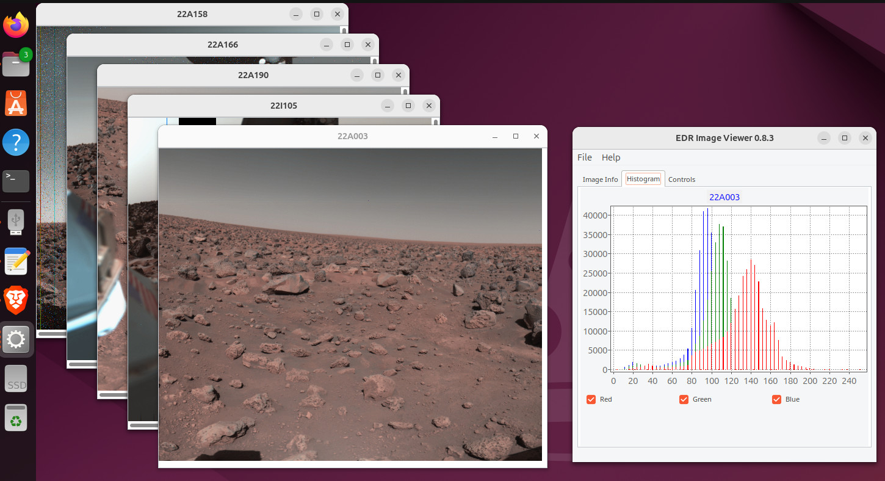

# EDRViewer

EDRViewer is an application capable of processing PDS and SFDU files containing EDR (Experiment Data Record) data originally acquired by JPL/NASA spacecraft.

Although it was originally designed to process files containing images and PDS3 labels specific to the Viking Landers, it can also process files containing PDS2 and SFDU labels with images from Mars Reconnaissance Orbiter (MRO), Mars Global Surveyor, Viking Orbiters and Voyager 1 and 2.
The application accepts data stored on file as fixed or variable length records, and compressed data records are decompressed using a lossless Huffman First Difference decompression algorithm.

EDRViewer is capable of processing monochrome, infrared or colour images from data source files or colour images. Colour is processed by combining the raw red, green and blue data from three separate soure files, and specific ratios are used to get colours to match wavelengths close to human response.

